<h1 align="center">VEGA-Music-AI</h1>

<p align="center"><b>Генератор песен на локальных нейросетях — для Windows.</b><br>
Опишите идею — получите текст и готовый трек с вокалом. Обучите свой голос — и треки будут петь им. Всё работает на вашем компьютере.</p>

<p align="center">
  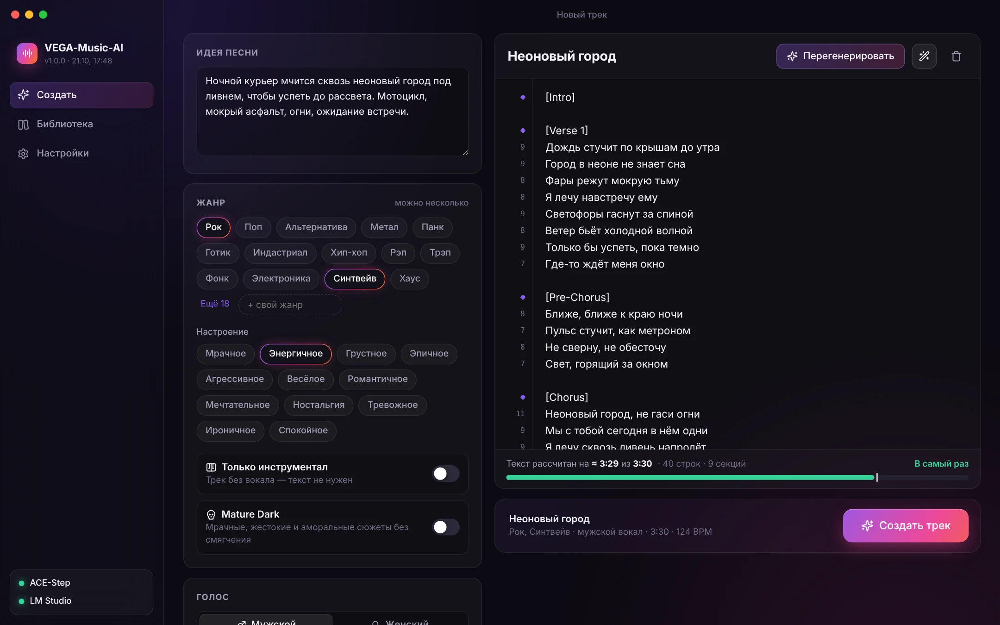
</p>

**VEGA-Music-AI** — настольное приложение, которое превращает описание песни в трек. Текст пишет языковая модель в [LM Studio](https://lmstudio.ai/) (по умолчанию Qwen3-14B), музыку и вокал — [ACE-Step 1.5](https://github.com/ACE-Step/ACE-Step-1.5), а свои голоса обучаются на [Seed-VC](https://github.com/Plachtaa/seed-vc). Интернет нужен только для установки: генерация полностью локальная.

Приложение берёт на себя то, на чём обычно спотыкаются генераторы: рассчитывает объём текста под длительность трека, повторяет припевы, убирает из текста ремарки и звуки, которые модель иначе «пропоёт», и закрепляет голос исполнителя, чтобы он не менялся по ходу песни.

## Возможности
- **Идея → текст → трек.** Опишите сюжет, выберите жанры (один или несколько, можно свой), настроение, голос и длительность.
- **Текст печатается в реальном времени** и сразу доступен для правки. Можно вставить и свой текст: теги секций на русском (`[Куплет 1]`, `[Припев]`) переводятся автоматически.
- **Текст ровно под длительность.** Объём рассчитывается от темпа (строка ≈ 2 такта, в рэпе ≈ 1 такт), припев повторяется дословно, интро, соло и аутро учитываются. Индикатор показывает, на сколько времени хватит текста.
- **Проверка текста.** Возле каждой строки — число слогов (длинные подсвечиваются), предупреждения о скобках, цифрах, латинице и непонятных тегах. Кнопка «Исправить» приводит текст к виду, который модель споёт без потерь.
- **Свои голоса (v2).** Загрузите песни — приложение само выделит вокал, нарежет фразы и обучит модель голоса. Голос можно выбрать при создании трека или перепеть им любой трек из библиотеки. Модель сохраняется одним файлом `.vegavoice` — её можно перенести на другой компьютер.
- **Стабильный голос.** Пол и тембр всегда передаются модели, а описание стиля не переписывается автоматически.
- **Только инструментал** — трек без вокала.
- **Mature Dark** — мрачные, жестокие и аморальные сюжеты без смягчения.
- **Живой прогресс.** Анимация, реальный прогресс, этапы и оставшееся время — для треков и для обучения голоса. Задание можно свернуть, прогресс виден и на значке в панели задач, по готовности приходит уведомление.
- **Библиотека.** Варианты трека, плеер с волной, отметка лучшего варианта, «Повторить» с теми же настройками и текстом, «Перепеть» своим голосом, поиск, удаление в корзину.
- **Бережёт видеопамять.** Модель текста выгружается из LM Studio, а ACE-Step останавливается перед обработкой голоса. Всё запускается автоматически.
- **Оформление в эстетике macOS** — собственная рамка окна и тёмная тема.

## Скриншоты

<table>
  <tr>
    <td width="50%">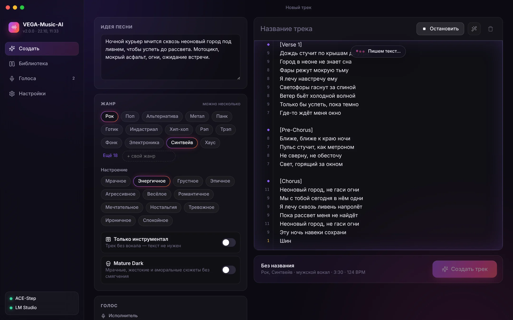</td>
    <td width="50%">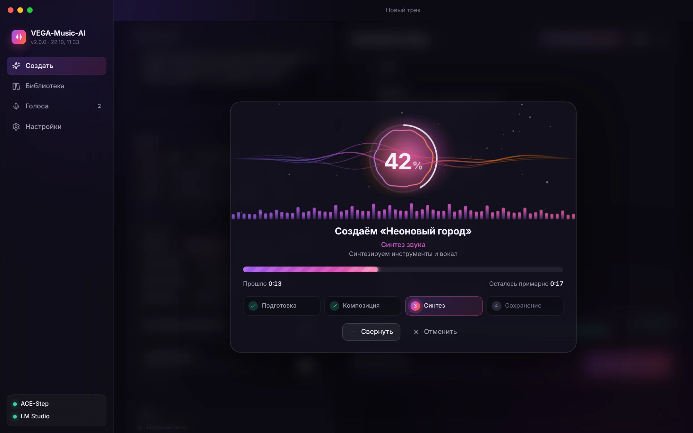</td>
  </tr>
  <tr>
    <td align="center"><sub><b>Текст</b> — модель пишет песню в реальном времени, слева число слогов</sub></td>
    <td align="center"><sub><b>Создание трека</b> — живая анимация, реальный прогресс и этапы</sub></td>
  </tr>
  <tr>
    <td>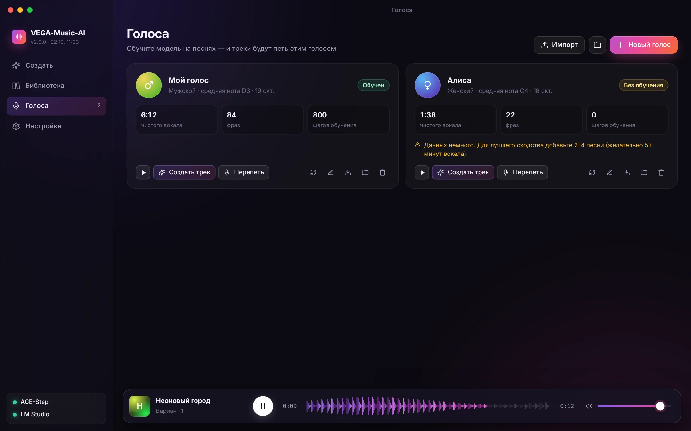</td>
    <td>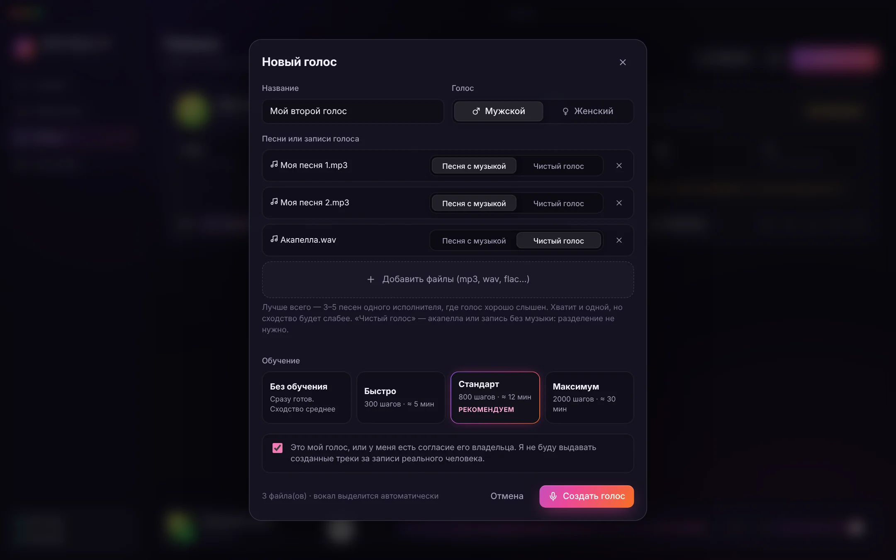</td>
  </tr>
  <tr>
    <td align="center"><sub><b>Голоса</b> — свои модели голоса, образец, перепевка, экспорт</sub></td>
    <td align="center"><sub><b>Новый голос</b> — песни с музыкой или чистый вокал, выбор длительности обучения</sub></td>
  </tr>
  <tr>
    <td>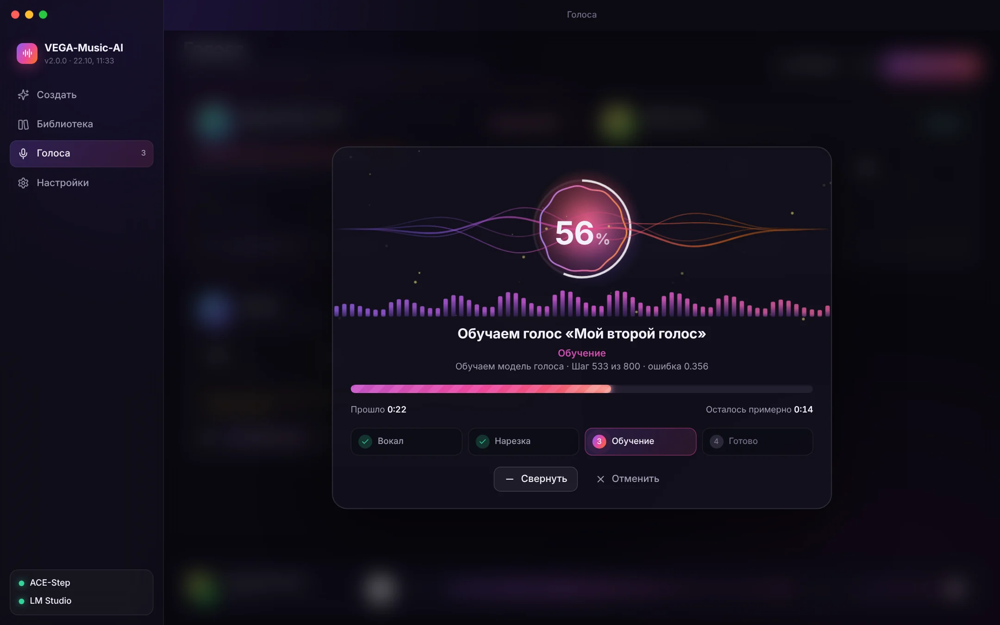</td>
    <td>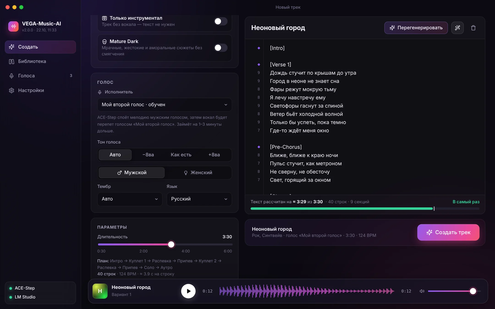</td>
  </tr>
  <tr>
    <td align="center"><sub><b>Обучение</b> — выделение вокала, нарезка фраз, обучение Seed-VC</sub></td>
    <td align="center"><sub><b>Свой исполнитель</b> — трек будет спет выбранным голосом</sub></td>
  </tr>
  <tr>
    <td>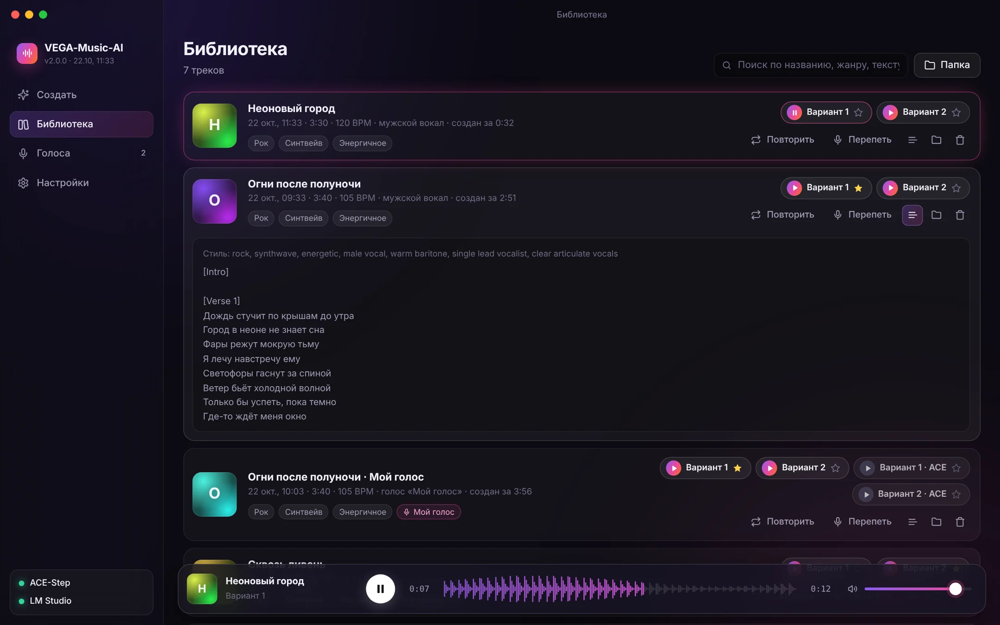</td>
    <td>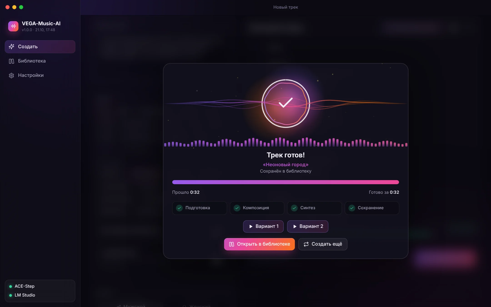</td>
  </tr>
  <tr>
    <td align="center"><sub><b>Библиотека</b> — варианты, исходники ACE, текст, плеер с волной</sub></td>
    <td align="center"><sub><b>Готово</b> — сразу можно послушать варианты</sub></td>
  </tr>
  <tr>
    <td>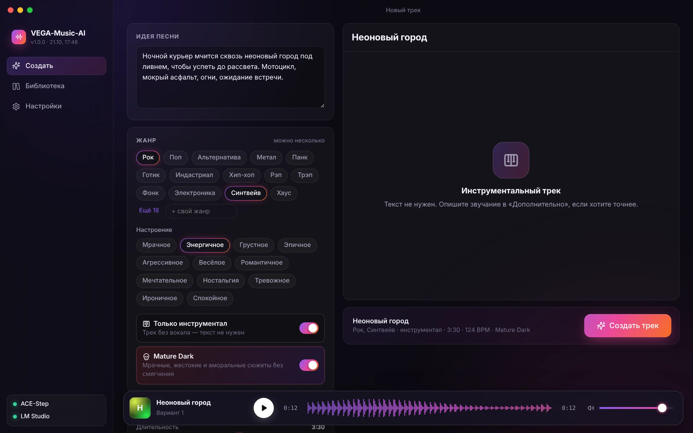</td>
    <td>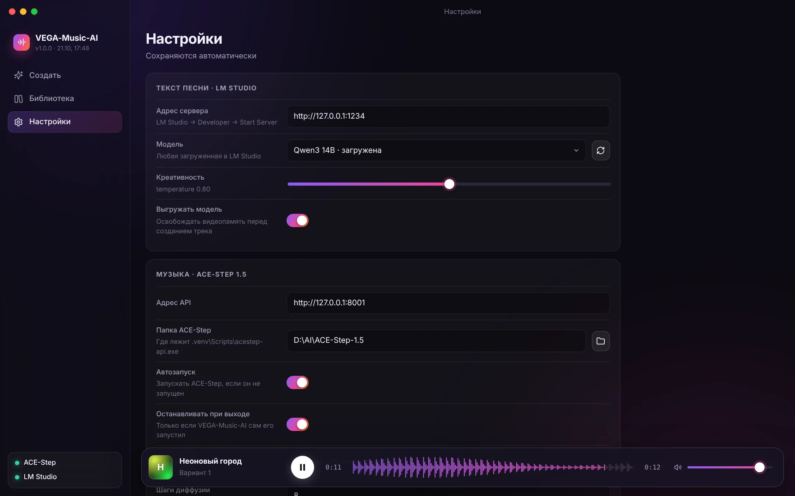</td>
  </tr>
  <tr>
    <td align="center"><sub><b>Инструментал</b> и режим <b>Mature Dark</b></sub></td>
    <td align="center"><sub><b>Настройки</b> — пути к компонентам и проверка одной кнопкой</sub></td>
  </tr>
</table>

<sub>Скриншоты сняты с реального интерфейса в демо-режиме (без подключённых моделей); текст песни и голоса на них демонстрационные.</sub>

## Как это работает
```
Идея, жанры, голос, длительность
        │
        ▼
План песни ── темп → секунд на строку → структура: интро, куплеты, припевы ×N, соло, бридж, аутро
        │
        ▼
LM Studio (Qwen3-14B) ── пишет уникальные секции с точным числом строк (поток в реальном времени)
        │
        ▼
Сборка и очистка текста ── повтор припевов, стандартные теги, без ремарок, цифры словами
        │                    → вы правите текст
        ▼
ACE-Step 1.5 ── описание стиля (жанры + пол и тембр вокала) + BPM + текст → 1–2 варианта трека
        │
        ├── свой голос выбран? ──► MelBand-RoFormer: вокал / музыка
        │                          ► Seed-VC: вокал перепевается вашим голосом (тональность сохраняется)
        │                          ► сведение с музыкой
        ▼
Библиотека (mp3 / wav / flac)

Новый голос: песни → MelBand-RoFormer (вокал) → нарезка на фразы 2–14 с → эталонный фрагмент
             → дообучение Seed-VC (певческая модель 44 кГц с учётом высоты тона) → голос готов
```

## Требования
- **Windows 10/11 (x64).**
- **Видеокарта NVIDIA.** Рекомендуется 16 ГБ видеопамяти и больше; минимум для настроек по умолчанию — 12 ГБ. Модели работают по очереди: перед созданием трека выгружается модель текста, перед обработкой голоса — ACE-Step.
- **[Node.js](https://nodejs.org/) LTS** — для сборки (`winget install OpenJS.NodeJS.LTS`).
- **[Git](https://git-scm.com/)** — чтобы скачать проект и компоненты (`winget install Git.Git`).
- **[LM Studio](https://lmstudio.ai/)** 0.3+ (рекомендуется 0.4+) с языковой моделью, например `qwen/qwen3-14b`.
- **[ACE-Step 1.5](https://github.com/ACE-Step/ACE-Step-1.5)** — Python 3.11–3.12 и [uv](https://docs.astral.sh/uv/). Модели (около 10 ГБ) скачиваются при первом запуске.
- **Для своих голосов (необязательно):** [Seed-VC](https://github.com/Plachtaa/seed-vc) (Python 3.10) и [melband-roformer-infer](https://github.com/openmirlab/melband-roformer-infer) — около 3 ГБ моделей.
- Свободное место: ~20 ГБ под модели плюс место под треки; каждый обученный голос — около 0,8 ГБ.

## Установка

### 1. ACE-Step 1.5 (музыка)
```powershell
# uv — менеджер окружений Python
powershell -ExecutionPolicy ByPass -c "irm https://astral.sh/uv/install.ps1 | iex"

# ACE-Step рядом с папкой VEGA-Music-AI (так приложение найдёт его само)
cd D:\AI
git clone https://github.com/ACE-Step/ACE-Step-1.5.git
cd ACE-Step-1.5
uv sync
```
Проверка: `uv run acestep-api` — при первом запуске скачаются модели. Когда в консоли появится адрес `http://127.0.0.1:8001`, сервер можно закрыть (`Ctrl+C`): дальше VEGA-Music-AI будет запускать его сам.

> Подойдёт и уже установленный ACE-Step 1.5 (например, из портативной сборки). Главное — чтобы в его папке был файл `.venv\Scripts\acestep-api.exe`. Путь указывается в настройках приложения.

### 2. LM Studio (текст)
1. Установите [LM Studio](https://lmstudio.ai/) и скачайте модель, например **Qwen3 14B** (`qwen/qwen3-14b`). Для 12 ГБ видеопамяти подойдёт модель поменьше: Qwen3 8B.
2. Включите сервер: **Developer → Start Server** (адрес по умолчанию `http://127.0.0.1:1234`).
3. Желательно включить «Just-in-Time model loading», чтобы модель загружалась сама по первому запросу.

### 3. VEGA-Music-AI
```powershell
cd D:\AI
git clone https://github.com/DS9-dev/VEGA-Music-AI.git
cd VEGA-Music-AI
.\setup_app.bat
```
Скрипт `setup_app.bat`:
1. проверит Node.js;
2. скачает компоненты (Electron и др., около 250 МБ, только в первый раз);
3. прогонит тесты ядра;
4. соберёт приложение в `release\win-unpacked\VEGA-Music-AI.exe`;
5. создаст ярлыки **VEGA-Music-AI** на рабочем столе и в меню «Пуск» и запустит приложение.

Дальше приложение запускается ярлыком или файлом `VEGA-Music-AI.bat`.

### 4. Свои голоса: Seed-VC и MelBand-RoFormer (необязательно)
Нужны только для вкладки «Голоса». Ставьте рядом с остальными компонентами — приложение найдёт их само.

**Seed-VC** (обучение и перепевка голоса):
```powershell
cd D:\AI
git clone https://github.com/Plachtaa/seed-vc.git Seed-VC
cd Seed-VC
py -3.10 -m venv .venv
.venv\Scripts\pip install torch==2.4.0 torchvision==0.19.0 torchaudio==2.4.0 --index-url https://download.pytorch.org/whl/cu121
.venv\Scripts\pip install -r requirements.txt
# первый запуск скачивает певческую модель 44 кГц, Whisper, BigVGAN и RMVPE (~2 ГБ)
.venv\Scripts\python inference.py --source examples\source\source_s1.wav --target examples\reference\s1p1.wav --output test --f0-condition True
```
> Если `pip install -r requirements.txt` пытается поставить ночную сборку PyTorch, удалите из файла первые три строки (`torch --pre …`) и повторите.

**MelBand-RoFormer** (выделение вокала из песни):
```powershell
cd D:\AI
mkdir StemSeparator; cd StemSeparator
py -3.12 -m venv .venv
.venv\Scripts\pip install torch torchaudio --index-url https://download.pytorch.org/whl/cu128
.venv\Scripts\pip install melband-roformer-infer
# модель (~900 МБ) скачается в папку models при первом разделении; можно заранее:
.venv\Scripts\melband-roformer-download --model melband-roformer-kim-vocals --output-dir models
```

Затем откройте **Настройки → Голоса** и нажмите **«Проверить»** — приложение подтвердит, что Seed-VC, веса, разделение вокала и видеокарта на месте.

## Настройка
Откройте **Настройки** в приложении — всё сохраняется автоматически.

| Параметр | Что указать |
|---|---|
| **LM Studio → Адрес сервера** | `http://127.0.0.1:1234`, если не меняли порт |
| **LM Studio → Модель** | выбирается из списка моделей LM Studio (кнопка ↻ обновляет список) |
| **Выгружать модель** | включено: перед созданием трека модель текста освобождает видеопамять |
| **ACE-Step → Папка** | папка ACE-Step 1.5. Ищется автоматически рядом с проектом; если не нашлась — укажите вручную |
| **Автозапуск / Останавливать при выходе** | приложение само запускает ACE-Step и закрывает его, если запускало само |
| **Модель DiT / Шаги** | `acestep-v15-turbo` и 8 шагов — быстро; `acestep-v15-base` и 32–64 шага — медленнее |
| **Формат файлов** | MP3, WAV или FLAC |
| **Голоса → Папка Seed-VC** | папка с `inference.py` и `.venv` |
| **Голоса → Разделение вокала** | папка с `.venv\Scripts\melband-roformer-infer.exe` |
| **Голоса → Модели MelBand-RoFormer** | папка, куда скачана модель `melband-roformer-kim-vocals` |
| **Голоса → Кэш Whisper** | необязательно: папка кэша, если Whisper для Seed-VC лежит отдельно (без интернета) |
| **Качество перепевки** | 30 шагов — хороший баланс; 40–50 — чище, но дольше |
| **Освобождать видеопамять** | включено: перед обработкой голоса ACE-Step останавливается (при следующем треке запустится снова) |
| **Папка треков / голосов** | по умолчанию `Library` и `Voices` в папке проекта |

Индикаторы внизу боковой панели показывают, запущены ли ACE-Step и LM Studio. ACE-Step можно запустить кнопкой «Запустить»; первый старт занимает 1–3 минуты.

## Как пользоваться
1. **Идея песни.** Опишите сюжет, героев, настроение и ключевые образы.
2. **Жанр и настроение.** Отметьте один или несколько жанров или впишите свой.
3. **Голос.** Мужской или женский, тембр и язык — или свой голос в поле «Исполнитель».
4. **Длительность.** Под ползунком виден план песни и число строк.
5. **«Сгенерировать текст»** — текст появится в редакторе. Поправьте его при необходимости: следите, чтобы индикатор внизу был зелёным («В самый раз»).
6. **«Создать трек»** — около 2–3 минут на трек длиной 3–4 минуты (зависит от видеокарты), со своим голосом — на 1–3 минуты дольше. Окно можно свернуть и слушать библиотеку.

### Свой голос
1. **Голоса → Новый голос.** Дайте название, укажите пол и добавьте песни. Для каждого файла выберите: «Песня с музыкой» (вокал выделится автоматически) или «Чистый голос» (акапелла, запись без музыки).
2. **Обучение.** «Без обучения» — голос готов сразу, сходство среднее. «Стандарт» (≈ 12 мин) — рекомендуемый вариант, «Максимум» (≈ 30 мин) — для 5+ минут вокала.
3. **Подтвердите**, что это ваш голос или у вас есть согласие его владельца.
4. Когда голос готов: **«Создать трек»** — откроется форма с выбранным исполнителем; **«Перепеть»** — перепеть трек из библиотеки; **▶** — послушать эталонный фрагмент.
5. **Экспорт** сохранит голос в файл `.vegavoice`, **Импорт** — добавит голос из такого файла.

**Как получить хорошее сходство**
- 3–5 песен одного исполнителя, где голос хорошо слышен и нет хора или дуэта. Лучше 5+ минут чистого вокала (приложение покажет, сколько набралось).
- Пол модели совпадает с голосом, которым ACE-Step поёт мелодию: приложение выставляет его само. «Тон голоса: Авто» сдвигает вокал на октаву, только если голос модели заметно выше или ниже, — тональность песни при этом не меняется.
- Если результат «шумит», попробуйте «Качество перепевки» 40–50 шагов или дообучите голос (кнопка ↻ в карточке).

**Советы по тексту**
- Строка в 6–10 слогов поётся чище всего. Красные цифры слева — повод разбить строку.
- Если пение заканчивается раньше трека — увеличьте **Плотность вокала** («Плотно») или добавьте строки. Если текст не помещается — «Свободно».
- Понравился вариант — зафиксируйте **Seed** в «Дополнительно» и меняйте только текст или стиль.
- В «Звучание, инструменты» лучше писать по-английски: `distorted guitars, dark synth pads`.

## Обновление
- **После правок в коде** просто снова запустите `setup_app.bat` — он пересоберёт exe и обновит ярлыки.
- **Новая версия с GitHub:** `git pull`, затем `setup_app.bat`.

Треки, голоса, настройки и логи при пересборке сохраняются: они лежат вне собираемых файлов. Перед обновлением закройте приложение — скрипт напомнит об этом.

## Где хранятся данные
| Что | Где | В Git? |
|---|---|---|
| Треки (аудио + `track.json` с текстом и параметрами) | `Library\` в папке проекта (меняется в настройках) | нет |
| Голоса (`voice.json`, эталон, фразы, модель `model\ft_model.pth`, журналы обучения) | `Voices\` в папке проекта (меняется в настройках) | нет |
| Настройки | `data\settings.json` | нет |
| Журнал ACE-Step | `data\logs\ace.log` | нет |
| Собранная программа | `release\win-unpacked\` | нет |
| Черновик формы и громкость плеера | хранилище окна приложения | нет |

## Решение проблем
| Симптом | Что сделать |
|---|---|
| ACE-Step не запускается | Проверьте папку в настройках и журнал `data\logs\ace.log`. Убедитесь, что `uv run acestep-api` работает в папке ACE-Step |
| «LM Studio не запущен» | Запустите LM Studio и включите сервер: Developer → Start Server |
| Нехватка видеопамяти | Оставьте «Выгружать модель» и «Освобождать видеопамять» включёнными, выберите 1 вариант вместо 2, уменьшите длительность или возьмите модель текста поменьше |
| Пение заканчивается раньше трека | Индикатор текста должен быть зелёным; повысьте «Плотность вокала» |
| Слова глотаются | Сократите красные строки, нажмите «Исправить» |
| Голос «плывёт» | Выберите конкретный тембр вместо «Авто», отключите бэк-вокал в скобках |
| Вкладка «Голоса» пишет, что компоненты не найдены | Настройки → Голоса → укажите папки Seed-VC и MelBand-RoFormer, нажмите «Проверить» |
| Обучение голоса падает | Смотрите `Voices\<голос>\train.log` и `prepare.log`. Чаще всего не хватает видеопамяти или Seed-VC ещё не скачал веса (запустите проверочную команду из раздела установки) |
| «В файлах не нашлось чистого вокала» | Голос в песнях слишком тихий или это хор. Добавьте другие песни или акапеллу |
| Оценка времени неточная | Она подстраивается после каждой генерации; сбросить — в настройках |

## Режим разработки
```powershell
.\start.bat          # запуск из исходников без сборки exe
npm test             # тесты ядра, интеграции с ACE-Step/LM Studio и голосов (на Windows тесты голосов пропускаются)
npm run test:voice   # тесты обработчика голоса (нужен Python с numpy и scipy)
npm run typecheck    # проверка типов
npm run dist         # только сборка exe
```
После `npm run build` файл `dist\renderer\index.html` можно открыть в браузере — интерфейс запустится в демо-режиме без моделей.

## Устройство
```
electron/        главный процесс: ACE-Step (REST + запуск процесса), LM Studio (поток, выгрузка модели),
                 библиотека, голоса, задания с прогрессом, настройки
src/shared/      ядро: план песни, очистка и анализ текста, описание стиля, промпт для модели текста
src/renderer/    интерфейс на React: создание, библиотека, голоса, плеер, настройки, анимация
voice/           обработчик голоса на Python (запускается окружением Seed-VC): разделение вокала,
                 нарезка фраз, оценка тона, обучение Seed-VC, перепевка, сведение, экспорт .vegavoice
tests/, voice/tests/   тесты (имитации ACE-Step, LM Studio, Seed-VC и MelBand-RoFormer)
scripts/         сборка (esbuild) и запуск тестов
setup_app.bat    сборка/обновление exe и ярлыков
```

## Планы
- Проверка пропетого текста через Whisper с подсветкой пропущенных строк.
- Дуэты: два своих голоса в одной песне по секциям.

## Ответственное использование
Создавайте голоса только из своих записей или с явного согласия их владельца. Не выдавайте сгенерированные треки за записи реальных исполнителей и соблюдайте права на чужие тексты и голоса. При создании голоса приложение просит подтвердить согласие.

## Лицензия
Код проекта распространяется по лицензии [MIT](LICENSE).

Сторонние компоненты устанавливаются отдельно, запускаются как отдельные программы и распространяются по своим лицензиям:
- Electron, React, esbuild, electron-builder — MIT; TypeScript — Apache-2.0;
- [ACE-Step 1.5](https://github.com/ACE-Step/ACE-Step-1.5) — MIT (код); условия использования моделей — в репозитории ACE-Step;
- [Seed-VC](https://github.com/Plachtaa/seed-vc) — GPL-3.0;
- [melband-roformer-infer](https://github.com/openmirlab/melband-roformer-infer) — MIT; веса MelBand-RoFormer — условия их авторов;
- LM Studio — лицензия LM Studio; языковые модели — лицензии их авторов (Qwen3 — Apache-2.0).
